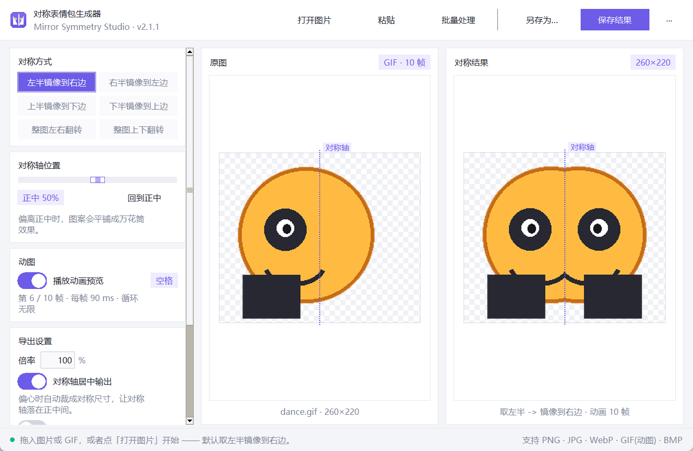
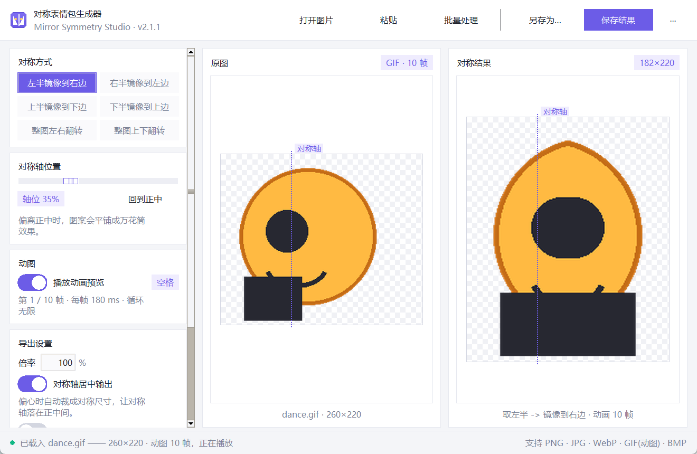
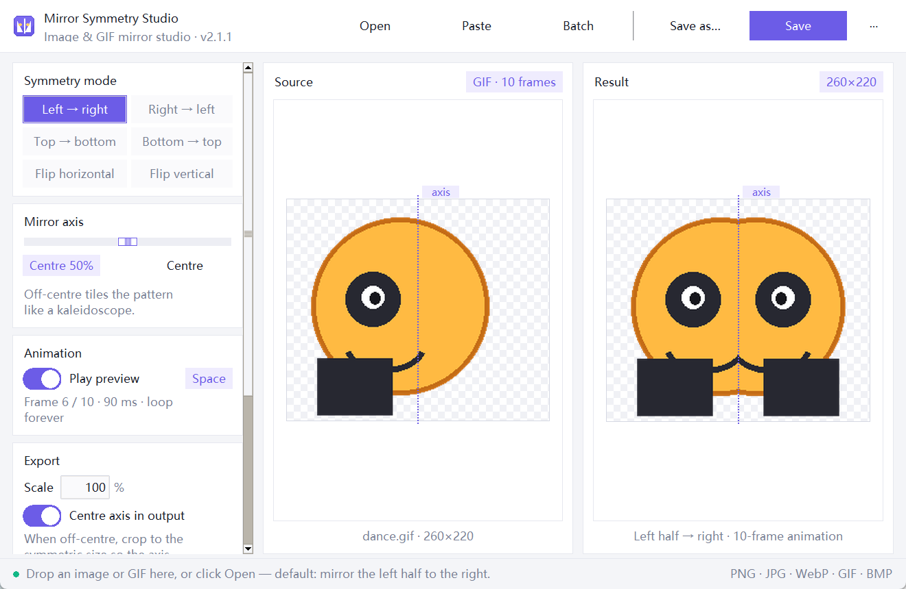

# 对称表情包生成器 · Mirror Symmetry Studio

把图片或 **GIF 动图**从中间切开，取一半镜像到另一半，
一键做出**左右对称 / 上下对称**的表情包、头像、贴纸。

**中英双语界面** · 单文件 exe 离线运行 · 只依赖 Pillow



<p align="center">
  
  
</p>

`v2.2.0` · Python 3.8+

---

## 三种用法

**1. 直接双击 exe（推荐，无需装 Python）**

```
dist\MirrorSymmetry.exe
```

**2. 双击 `启动.bat`** —— 自动找 exe，找不到就用本机 Python（缺 Pillow 会自动装）

**3. 命令行 / 开发模式**

```bat
python -m pip install -e .
mirror-symmetry                  :: 图形界面
mirror-symmetry 图片.gif         :: 直接打开某个文件
mirror-symmetry --selftest       :: 无界面自检，写出 selftest_report.txt
```

---

## 功能一览

**六种对称方式**

| 模式 | Mode | 效果 |
| --- | --- | --- |
| 左半镜像到右边 | Left → right | 取左半翻到右边，最常用的「正面对称」 |
| 右半镜像到左边 | Right → left | 取右半翻到左边 |
| 上半镜像到下边 | Top → bottom | 取上半翻到下边 |
| 下半镜像到上边 | Bottom → top | 取下半翻到上边 |
| 整图左右翻转 | Flip horizontal | 整张图水平翻转（不裁切） |
| 整图上下翻转 | Flip vertical | 整张图垂直翻转（不裁切） |

**对称轴居中输出**（v2.1 新增）

拖动对称轴后，默认开启「对称轴居中输出」：只保留切线一侧的半张图并镜像，
输出画布自动裁成对称尺寸，**对称轴永远落在结果正中间**。
关掉它则保持原尺寸、图案像万花筒一样平铺。

| 对称轴 | 居中输出 | 原尺寸输出 |
| --- | --- | --- |
| 50% | 260×220（不变） | 260×220 |
| 35% | 182×220，轴在正中 | 260×220，图案平铺 |

**输出尺寸**

- `自动`：显示按倍率算出的实际尺寸（chip 里实时更新），按倍率缩放
- `自定义`：直接填 `宽 × 高`（例如 512×512），**动图的每一帧一起缩放到该尺寸**
- `补成正方形（透明边）`：把结果补成正方形，适合表情包 / 头像

**GIF 动图**

- 逐帧对称，不漏帧；保留帧顺序、每帧时长、循环次数
- 预览区里原图与结果并排自动播放，`空格` 播放 / 暂停
- 导出动画 **GIF** 或动画 **WebP**（动画 WebP 无损，无残影、通常比 GIF 小很多）
- 存 PNG / JPG / BMP 时只存当前帧，并明确提示

**批量处理**：选一个文件夹按当前设置全部处理，带进度窗口；
动图出动画 GIF，静态图出 PNG。

---

## 界面 & 语言

- **左侧栏**：对称方式（分段选择器）、对称轴滑杆、动图开关、导出设置；内容多时可滚动
- **右侧**：原图与结果并排预览，紫色虚线是对称轴，透明区域显示棋盘格
- **顶部**：打开 / 粘贴 / 批量处理 / 另存为 / 保存结果，最右 `⋯` 是菜单
- **中英切换**：菜单 `⋯` → **语言 / Language** → 中文 / English
  （英文界面整体字号会大一号，英文看起来更舒服）
- **界面缩放**：菜单 `⋯` → **界面缩放 / UI scale** → 100% / 110% / 125% / 150%，字体、侧栏、预览一起放大
- 设置全部记住：窗口大小、语言、模式、轴位、倍率、自定义尺寸、底色
  （存在 `%APPDATA%\MirrorSymmetry\settings.json`）

## 快捷键

| 快捷键 | 功能 |
| --- | --- |
| `Ctrl + O` | 打开图片 / 动图 |
| `Ctrl + V` | 从剪贴板粘贴（配合 Win+Shift+S 截图很好用） |
| `Ctrl + S` | 保存结果 |
| `Ctrl + Shift + S` | 另存为 |
| `Ctrl + R` | 清空 |
| `空格` | 播放 / 暂停动画预览 |
| `←` `→` `↑` `↓` | 切换对称方式 |
| `F1` | 关于 |

---

## 项目结构

```
对称表情包/
├─ dist/MirrorSymmetry.exe     打包好的单文件应用（双击即用）
├─ src/mirror_symmetry/
│  ├─ core.py                  图像引擎：镜像算法、轴居中裁切、GIF/WebP 读写、批量导出
│  ├─ ui.py                    现代 Tkinter 界面 + 入口 + 自检
│  ├─ theme.py                 配色 / ttk 主题 / 程序图标（随语言调字号）
│  ├─ i18n.py                  中英文案表
│  ├─ config.py                设置持久化（%APPDATA%）
│  └─ __main__.py              python -m mirror_symmetry
├─ tests/test_core.py          15 组单元测试（像素级对称 + 动图往返 + 轴居中 + 尺寸）
├─ scripts/build_exe.py        一键打包 exe
├─ scripts/entry.py            PyInstaller 入口
├─ mirror_symmetry.py          兼容入口（python mirror_symmetry.py）
├─ 启动.bat                     双击启动
└─ pyproject.toml              包定义与依赖
```

## 开发

```bat
python -m pip install -e .[dev]
python -m unittest discover -s tests     :: 15 组测试
python mirror_symmetry.py --selftest     :: 快速自检

python -m pip install -e .[build]        :: 装 PyInstaller
python scripts/build_exe.py              :: 打包 -> dist\MirrorSymmetry.exe
dist\MirrorSymmetry.exe --selftest       :: 验证打包结果
```

可选：`pip install tkinterdnd2` 后支持把图片直接拖进窗口。

## 许可

MIT

